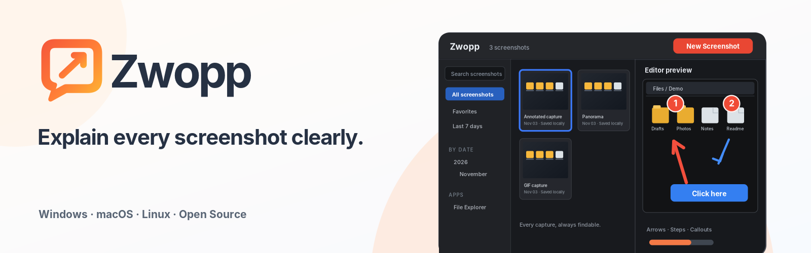
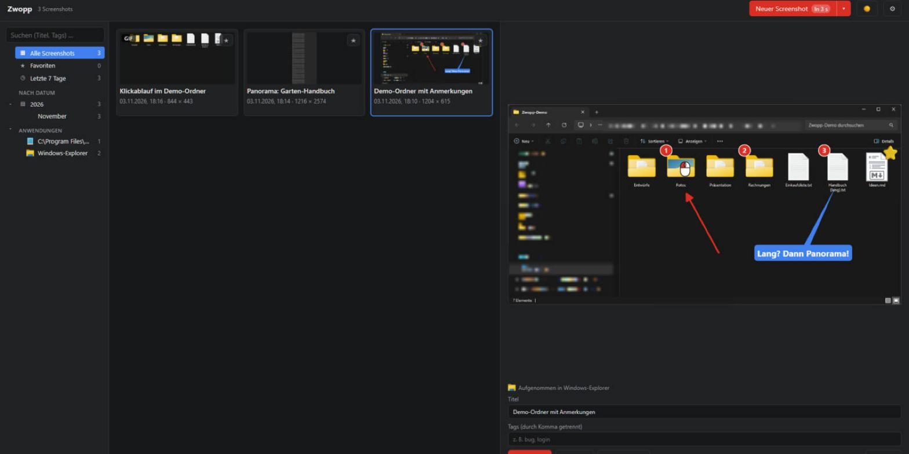

  <picture>
    <source media="(prefers-color-scheme: dark)" srcset="docs/media/brand/banner-dark.png">
    
  </picture>

  
  
  
  
  

  <a href="https://cwecode.github.io/zwopp/">Website</a> ·
  <a href="#download">Download</a> ·
  <a href="docs/user-guide.md">User guide</a> ·
  <a href="CHANGELOG.md">Changelog</a> ·
  <a href="https://github.com/cwecode/zwopp/discussions">Discussions</a>

# Zwopp

A lean, open-source screenshot tool for **Windows, macOS and Linux**: take a screenshot,
add **arrows, numbered steps and callouts** in seconds, and paste it straight into
**Teams, Slack, an email or a ticket** – for work instructions, quick answers in chat and
bug reports. Every shot stays in a **library** you can search.

## Why Zwopp?

- **An editor made for explaining.** Arrows, step numbers, callouts, mouse stamps, a
  magnifier, highlighter and pixelate – a how-to in one picture. Annotations stay
  editable; the original is never changed.
- **Shared in seconds.** Ctrl+Shift+C copies the finished image; or drag it into Teams,
  Slack, an email or a ticket. GIFs stay animated.
- **A library, not a folder of files.** Every capture is kept, sorted by date and by the
  application it came from, and found again by title or tag – fast even with 100 000.
- **Scrolling screenshots and GIFs.** A panorama joins a long page while you scroll; a GIF
  records a click sequence, ready to paste into a chat.
- **Freeze first, select later.** One hotkey freezes every monitor; drag a region, click a
  window, or Shift+click a whole screen.
- **For scripts and AI agents.** `zwopp capture --window Firefox` takes a screenshot from
  the command line; Claude Code gets a skill with one click.
- **Local, private, yours.** No account, no cloud, no telemetry: Zwopp sends nothing
  anywhere and opens no network port. Export the whole library any time, with readable
  file names, tags as XMP and a JSON and CSV index.
- **Open source, on every desktop.** Windows 10/11, macOS (Apple silicon and Intel) and
  Linux including Wayland; MIT or Apache-2.0.

## Download

| | Latest version | |
|---|---|---|
| **Windows** 10/11 | [**Download for Windows**](https://github.com/cwecode/zwopp/releases/latest/download/Zwopp-windows-x64-setup.exe) | installer, 64-bit |
| **macOS** | [**Download for Apple silicon**](https://github.com/cwecode/zwopp/releases/latest/download/Zwopp-macos-apple-silicon.dmg) · [Intel](https://github.com/cwecode/zwopp/releases/latest/download/Zwopp-macos-intel.dmg) | M1 or newer · older Macs |
| **Linux** | [**Download for Linux (AppImage)**](https://github.com/cwecode/zwopp/releases/latest/download/Zwopp-linux-x86_64.AppImage) · [.deb](https://github.com/cwecode/zwopp/releases/latest/download/Zwopp-linux-amd64.deb) · [.rpm](https://github.com/cwecode/zwopp/releases/latest/download/Zwopp-linux-x86_64.rpm) | Ubuntu 24.04, Debian 13 or newer |

The first start asks once, since the downloads are not signed: see [Install](#install).
After that, Zwopp offers new versions itself, and installs them only when you click. All
files and checksums are on the [Releases](https://github.com/cwecode/zwopp/releases/latest) page.

More pictures: library, capture overlay, panorama

## Features

- **Capture:** global hotkey **Ctrl+Shift+X** (macOS **⌘⇧X**, or your own) or the tray menu;
  all monitors freeze, a magnifier helps to hit the pixel, optional delay of 3/5/10 s.
  Modes: screenshot, **panorama** and **GIF** with pointer and clicks.
- **Library:** sidebar by favorites, recent days, year, month and application; search,
  tags, copy, export, drag into other apps; export of the whole library.
- **Editor:** eight tool families with keyboard shortcuts, quick styles (1–9), layers and
  blocks, a filmstrip of the library, copy and paste between screenshots; copy the result,
  export it as PNG, JPG or WebP, or drag it into another app.
- **Everywhere one click:** library, editor and a new screenshot at the top of every view.
- **Runs in the tray;** a closed window frees its memory after two minutes.
- **Updates on request** and **Report a problem**, which opens a GitHub issue filled in
  with version and system – nothing is sent from Zwopp.

The [user guide](docs/user-guide.md) explains everything, with all
[editor shortcuts](docs/user-guide.md#the-editor); the [feature list](docs/spec/features.md)
and the [project plan](docs/PLAN.md) (German) show what comes next.

### Screenshots for your AI agent

AI agents take screenshots, find them in your library and look at them – "take a
screenshot of the login dialog and attach it to the issue". They run Zwopp's command
line, on Windows, macOS and Linux.

- **Claude Code: Install skill** in *Settings › AI agents and command line*. A
  [skill](skills/zwopp/SKILL.md) tells Claude Code when and how to run Zwopp; it costs
  context only when it is used.
- **Other agents with a terminal** run the same commands; tools that read Agent Skills
  can use [`skills/zwopp`](skills/zwopp) too.

Scripts use the same executable: `zwopp capture --window Firefox --out shot.png`,
`zwopp list --json`, `zwopp export <id> shot.webp` ([more](docs/user-guide.md#command-line-and-ai-agents)).

## Install

Download the installer for your system above or from the [Releases](../../releases) page.
The downloads are not signed, so the first start asks once:

- **Windows** (`Zwopp-windows-x64-setup.exe` or the `.msi`): SmartScreen shows "Windows
  protected your PC" → *More info* → *Run anyway*.
- **macOS** (`Zwopp-macos-apple-silicon.dmg` or `Zwopp-macos-intel.dmg`): right-click the
  app → *Open*, or *System Settings → Privacy & Security → Open Anyway*. Then allow
  *Screen Recording* for Zwopp.
- **Linux** (AppImage, `.deb` or `.rpm`): no extra steps. Needs Ubuntu 24.04, Debian 13 or
  a similarly recent distribution (PipeWire ≥ 1.0).

Each release lists SHA-256 checksums in `SHA256SUMS.txt`; [CHANGELOG.md](CHANGELOG.md)
lists what changed.

## Build and contribute

`npm install && npm run dev` starts Zwopp from source. Prerequisites, project layout,
checks and the performance budgets are in [docs/development.md](docs/development.md);
how to contribute is in [CONTRIBUTING.md](CONTRIBUTING.md). Questions and ideas are welcome
in [Discussions](https://github.com/cwecode/zwopp/discussions), security problems go
privately via [SECURITY.md](SECURITY.md).

## License

Licensed under either of [Apache License 2.0](LICENSE-APACHE) or [MIT](LICENSE-MIT) at your option.

Zwopp is an independent project and is not affiliated with any commercial screenshot software.
