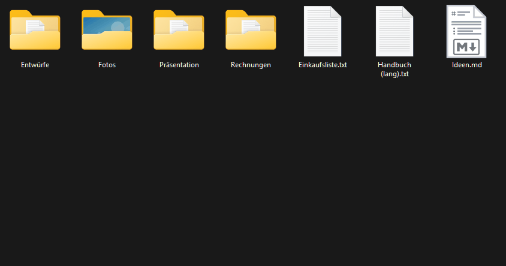
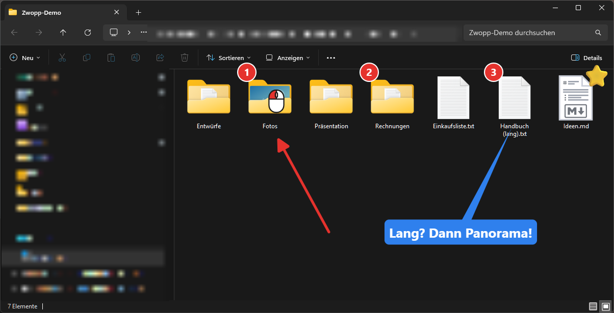
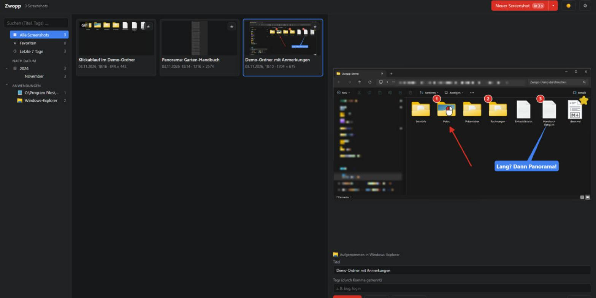
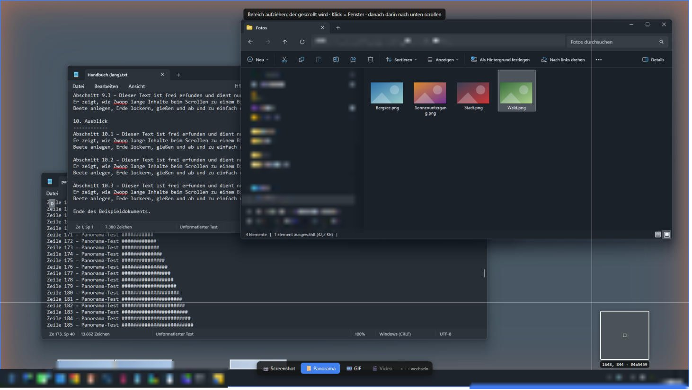
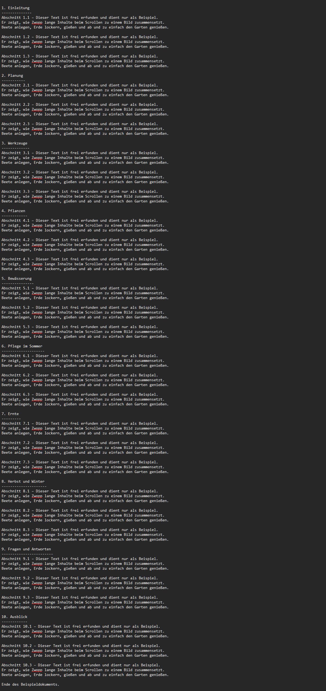

# Zwopp

A lean, open-source screenshot tool for **Windows, macOS and Linux**: select a region,
the screenshot lands in a **library**, and an **editor** lets you add arrows, callouts,
highlights, step numbers, emojis and more.

> **Version 1.2.** Screenshots, panoramas and GIFs, library, the full editor and the
> settings; the library stays fast with 100 000 screenshots. See the [user guide](docs/user-guide.md), the
> [feature list](docs/spec/features.md) and the [project plan](docs/PLAN.md) (German).



**Capture modes:** a bar at the bottom of the screen switches between a screenshot, a
**panorama** (select an area, scroll down in it, and Zwopp joins everything into one tall
image) and a **GIF** of a click sequence, like the one above, ready to paste into a chat.



Every capture lands in the **library**, sorted by date and by the application it came from,
and opens in the **editor** for arrows, step numbers, callouts, emojis, mouse stamps and
pixelating what nobody should see.

<details>
<summary>More pictures: library, capture overlay, panorama</summary>







</details>

## Features (current)

- Global hotkey **Ctrl+Shift+X** (macOS: **⌘⇧X**) or tray menu → region capture.
  If another app owns that key, Zwopp falls back to Ctrl+Alt+X, then Ctrl+Shift+2;
  the active one is shown in the library toolbar. Pick your own in the settings
- "Freeze first, select later": all monitors are frozen, then you drag a region, also across
  monitors, with a magnifier at the cursor. Click = the window under the mouse,
  Shift+click = whole monitor, Esc / right-click = cancel. Optional delay of 3/5/10 s.
- **Capture modes** (bar at the bottom, ←/→): screenshot, **panorama** (scroll down in the
  area, Zwopp joins it into one tall image) and **GIF** of a click sequence, with pointer
  and clicks; copy, drag or export the GIF and it stays animated
- Every capture is saved to the library, copied to the clipboard and opened in the editor
- **Library:** a sidebar by favorites, recent days, year and month, and the application a
  screenshot was taken in (with its icon); thumbnails, search (title, tags), tags, copy,
  export, drag into other apps, delete
- **Editor:** tools in a rail of eight families, with one-time tips; arrow, line, pen,
  rectangle, ellipse (outlined or filled), text box (three fonts,
  optional coloured background), callout, step numbers (counting or fixed), mouse stamps
  (clicks, scroll, drag), emoji stickers, magnifier,
  highlighter, pixelate, fill bucket, magic wand (cut out objects); colors, sizes
  and arrowheads (filled, open, at either end);
  move/resize; undo/redo; autosave; copy the annotated image, export it as PNG, JPG or WebP,
  or drag it into another app. Draw outside the screenshot
  and the canvas grows (transparent background); mark an area and press Del to delete it.
  A layers panel lists every element and lets you add, hide, lock and reorder layers.
  A filmstrip shows the library; copy a whole edit or a selection and paste it into another
  screenshot as a movable block.
  Annotations stay editable ([format](docs/spec/document-format.md)), the original is never changed
- **Quick styles:** save a tool's colour, size and shape with "+", apply it with a click or
  1–9, share them as a file. Every tool starts with its style from last time
- **Settings** (⚙ in the library or the tray menu): language, light or dark appearance,
  start at login, capture hotkey, library folder, whether a capture is copied and opened
  in the editor
- Runs in the system tray; closing the window keeps it running and frees its memory
  after two minutes

### Editor shortcuts

| Key | Action |
|---|---|
| V / A / L / R / E | Select / Arrow / Line / Rectangle / Ellipse |
| T / C / N | Text / Callout / Step number (Shift+click repeats the last) |
| K | Mouse stamp |
| P / F / W | Pen / Fill bucket / Magic wand |
| S / M | Emoji sticker / Magnifier |
| H / B | Highlighter / Pixelate |
| 1 – 9 | Apply the tool's first nine quick styles |
| Ctrl+Z, Ctrl+Y | Undo, redo |
| Drag on empty area (V) | Mark an area |
| Del | Delete marked area, or the selected shapes |
| Shift+click, Ctrl+A | Add to selection, select all |
| Ctrl+↑ / Ctrl+↓ | Bring forward / send backward (with Shift: to front / back) |
| Ctrl+C | Copy selection – or, with nothing selected, the whole edit (screenshot + annotations) |
| Ctrl+V | Paste as a block (also into another screenshot) |
| Ctrl+Shift+C | Copy the finished image to the system clipboard |
| Ctrl+Shift+S | Export the finished image as PNG, JPG or WebP |
| Alt+← / Alt+→ | Previous / next screenshot from the filmstrip |
| Ctrl+wheel, Ctrl++ / Ctrl+− | Zoom (at the cursor) |
| Ctrl+0 / Ctrl+1 | Fit ("Einpassen", fills the window) / actual pixels (100 %) |
| Ctrl+G / Ctrl+Shift+G | Make a block from the selection / dissolve it |
| Double-click a block | Open it to edit single elements |
| Wheel, Space+drag, middle mouse | Pan |
| Double-click text | Edit text (Esc or Ctrl+Enter to finish) |

## Install

Download the installer for your system from the [Releases](../../releases) page. The
downloads are not signed, so the first start asks once:

- **Windows** (`…_x64-setup.exe` or `.msi`): SmartScreen shows "Windows protected your PC" →
  *More info* → *Run anyway*.
- **macOS** (`…_aarch64.dmg` for Apple silicon, `…_x64.dmg` for Intel): right-click the app →
  *Open*, or *System Settings → Privacy & Security → Open Anyway*.
- **Linux** (AppImage, `.deb` or `.rpm`): no extra steps. Needs Ubuntu 24.04, Debian 13 or a
  similarly recent distribution (PipeWire ≥ 1.0).

Each release lists SHA-256 checksums in `SHA256SUMS.txt`. The [user guide](docs/user-guide.md)
explains everything from the first capture to the settings; [CHANGELOG.md](CHANGELOG.md) lists
what changed.

## Run from source

### Prerequisites

| | |
|---|---|
| All | [Git](https://git-scm.com), [Rust](https://rustup.rs) (stable, ≥ 1.90), [Node.js](https://nodejs.org) LTS |
| Windows | Visual Studio 2022 or Build Tools with **"Desktop development with C++"**; WebView2 (preinstalled on Windows 11) |
| macOS | Xcode Command Line Tools: `xcode-select --install` |
| Linux (Debian/Ubuntu) | Ubuntu 24.04 / Debian 13 or newer, see below |

```bash
sudo apt install libwebkit2gtk-4.1-dev libayatana-appindicator3-dev librsvg2-dev \
  build-essential curl wget file libssl-dev pkg-config libclang-dev \
  libxcb1-dev libxrandr-dev libdbus-1-dev libpipewire-0.3-dev libwayland-dev libegl-dev libgbm-dev
```

Other distributions: see the [Tauri prerequisites](https://tauri.app/start/prerequisites/).

### Start

```bash
git clone https://github.com/cwecode/zwopp.git
cd zwopp
npm install
npm run dev
```

`npm run build:app` builds an optimized, unsigned binary at
`target/release/zwopp` (`.exe` on Windows) that you can start directly.

### Permissions

- **macOS:** allow *Screen Recording* for your terminal (dev) or for Zwopp (build) in
  *System Settings → Privacy & Security*.
- **Linux/Wayland:** the desktop portal asks for permission on the first capture.

## Project layout

```
apps/desktop/          Tauri app: React UI (src/) and Rust shell (src-tauri/)
crates/core/           zwopp-core: capture, library, export (no UI)
docs/                  plan, architecture decisions (adr/), feature spec (spec/)
```

All functionality lives in `zwopp-core`; the desktop app is a thin layer on top.
That keeps the planned CLI, HTTP API and MCP server (v2) on the same code path.

## Development

```bash
npm run dev            # app with hot reload
npm test               # Rust tests
npm test -w apps/desktop   # TypeScript unit tests (Vitest)
npm run typecheck      # TypeScript
cargo clippy --workspace --all-targets -- -D warnings
cargo fmt --all
cargo deny check       # vulnerabilities, licenses (deny.toml; cargo install cargo-deny)
```

CI runs the TypeScript checks once, the Rust checks on Windows, macOS and Linux, builds
the Windows installer and checks the dependencies; changes to docs alone skip it. The
performance budgets run when the library or the UI changes, and every night.

The development build runs as **Zwopp Dev** (identifier `digital.weier.zwopp.dev`), with
its own settings and library, next to an installed Zwopp; it never starts at login
(see [ADR 0008](docs/adr/0008-running-in-the-background.md)).

### Performance

The library is built for 100 000+ screenshots (see [ADR 0004](docs/adr/0004-library-performance.md)).

```bash
# Benchmarks (default 20 000 items; set ZWOPP_BENCH_ITEMS for more)
cargo bench -p zwopp-core --bench library
# Fill a library folder with synthetic items, e.g. to try the app with 100 000
cargo run -p zwopp-core --release --example seed -- <library-dir> 100000
```

Start the app on such a library (your own library stays untouched) by setting
`ZWOPP_LIBRARY_DIR=<library-dir>` before `npm run dev`.

The budgets from [docs/PLAN.md](docs/PLAN.md) (Phase 1.5) are checked in CI with
100 000 items; run them locally with:

```bash
# Core: paging, search, adding a screenshot (release build)
cargo test -p zwopp-core --release --test budgets -- --ignored --nocapture
# UI: first thumbnails, scrolling, jumps, search, memory (once: npx playwright install chromium)
npm run test:budgets -w apps/desktop
```

See [CONTRIBUTING.md](CONTRIBUTING.md).

## License

Licensed under either of [Apache License 2.0](LICENSE-APACHE) or [MIT](LICENSE-MIT) at your option.

Zwopp is an independent project and is not affiliated with any commercial screenshot software.
